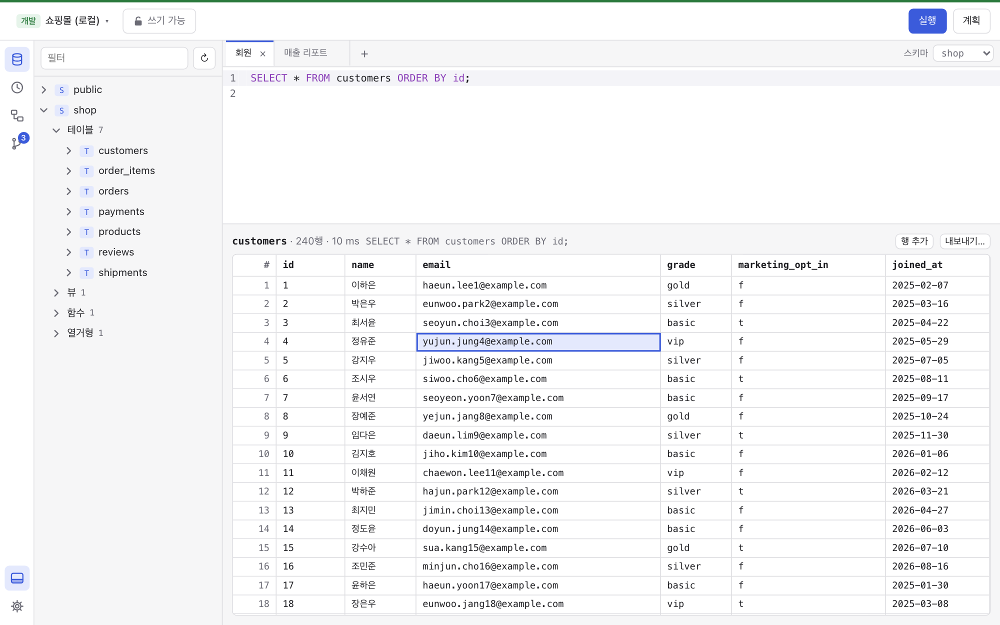
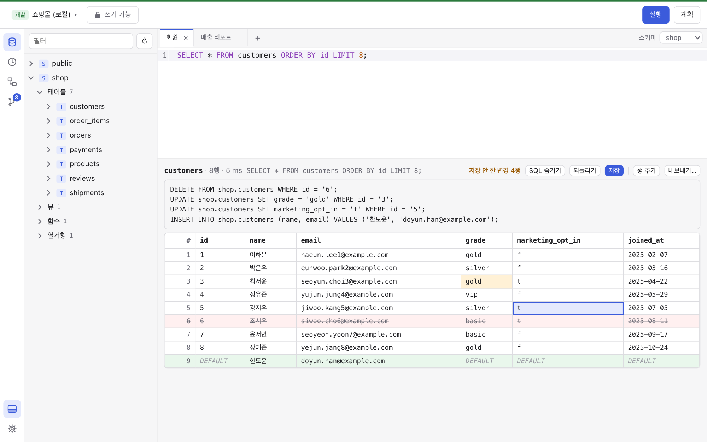
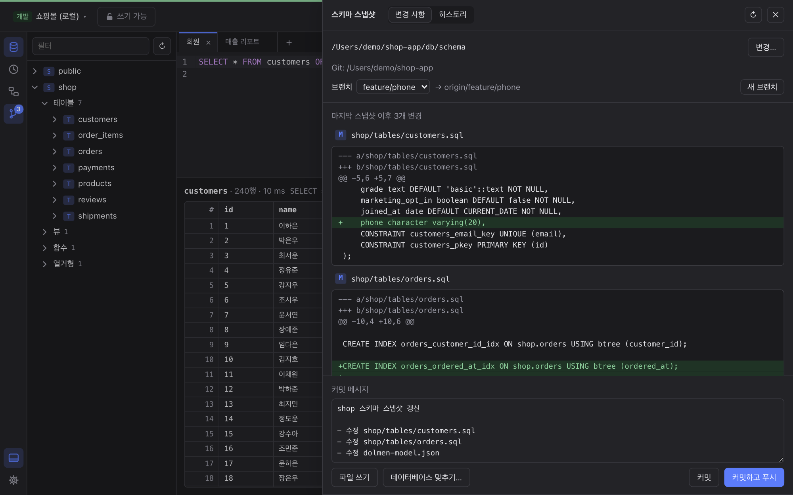
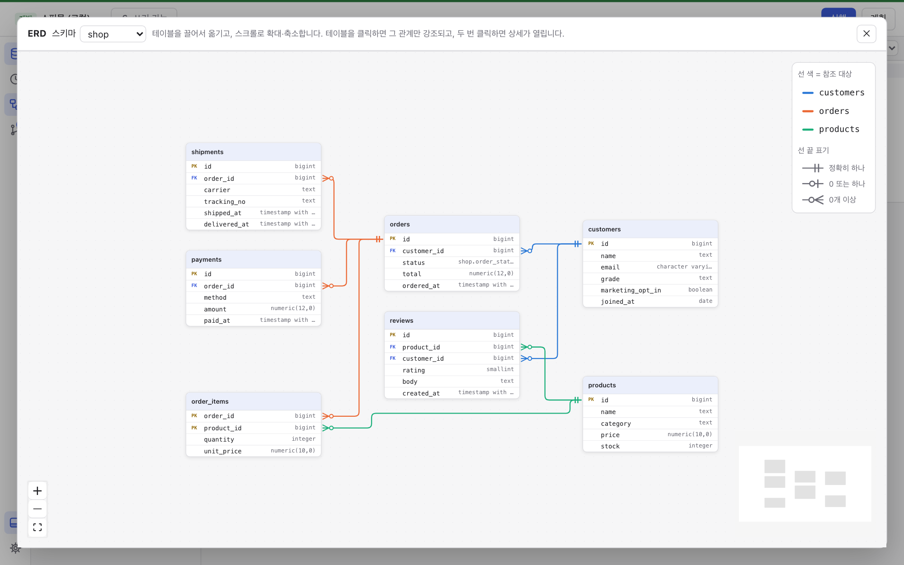
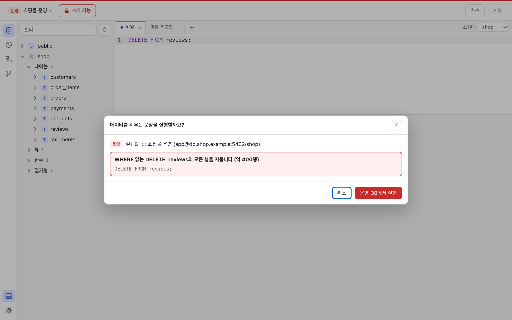
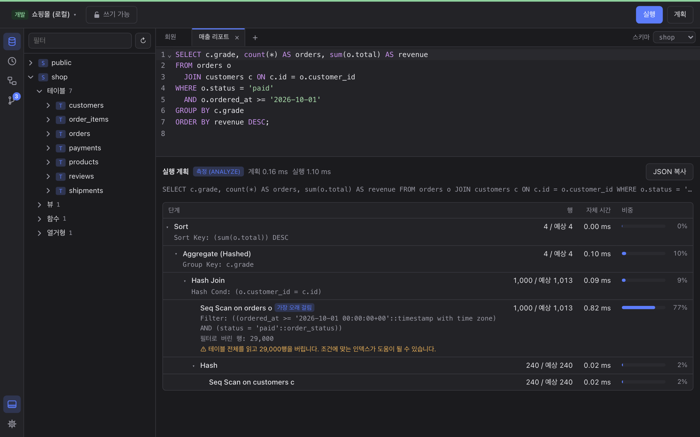

# Dolmen

**테이블의 역사를 Git에 남기는 데이터베이스 클라이언트**

**한국어** · [English](README.en.md)

<p align="center">
  <a href="https://github.com/whalebanana86/ai-dolmen/releases/latest"><b>⬇︎ 내려받기 (macOS · Windows · Linux)</b></a>
</p>

PostgreSQL 데이터베이스에 연결해 SQL을 실행하고, 결과를 표에서 바로 고치고,
**테이블 구조가 바뀔 때마다 Git에 기록**하는 오픈소스 데스크톱 앱이에요. 아직 초기
버전이고, 지금은 PostgreSQL만 연결할 수 있어요.

## 이 앱은 뭐예요?

데이터베이스 클라이언트는 데이터베이스에 SQL을 보내고 결과를 표로 보는 프로그램이에요.
DataGrip, DBeaver, TablePlus 같은 것들이요. Dolmen도 그 일을 하고, 거기에 세 가지를 더해요.

- **구조를 Git에 남겨요.** 테이블·뷰·함수의 구조를 파일로 써서 코드 옆 저장소에
  커밋해요. 누가 언제 무엇을 바꿨는지 코드처럼 남아요.
- **코드처럼 되돌려요.** 브랜치를 바꾸거나 예전 커밋을 고르면, 내 컴퓨터의
  데이터베이스를 그때 구조로 맞춰 줘요.
- **운영 데이터베이스를 지켜요.** 운영 DB는 읽기 전용으로 열고, 데이터를 지우는 문장은
  실행하기 전에 몇 행이 영향을 받는지 보여 주고 물어봐요.



> 이 README의 그림은 모두 지어낸 예시 데이터(커피 쇼핑몰, 지어낸 사람 이름)로 찍었어요.

이름 *Dolmen*은 고인돌이에요. "돌 탁자"라는 뜻으로, 수천 년을 버텨 온 유적이에요. 전 세계
고인돌의 약 40%가 한반도에 있어요. 여러분의 테이블 이력도 그만큼 오래 남으라고 지은
이름이에요.

## 왜 만들었어요?

1. **"이 컬럼 언제 누가 바꿨지?"** — 코드는 Git에 다 남는데, 데이터베이스 구조를 바꾼
   기록은 어디에도 없을 때가 많아요.
2. **브랜치마다 데이터베이스 구조가 달라요** — 기능 브랜치에서 테이블을 바꾸고 main으로
   돌아오면 로컬 데이터베이스는 그대로라 앱이 깨져요.
3. **운영 DB에서는 실수 한 번이 커요** — `WHERE`가 빠진 `UPDATE`, 개발 DB인 줄 알고 연 운영
   연결 같은 것들이요.
4. **스키마 버전관리는 비싼 도구에 있어요** — 비슷한 기능은 대개 상용 도구의 상위 에디션에
   들어 있어요.

그래서 Dolmen은 스키마 버전관리를 기본으로 넣은, 가볍고 무료인 오픈소스 클라이언트로
만들고 있어요.

## 설치하는 방법

### 내려받기

[Releases 페이지](https://github.com/whalebanana86/ai-dolmen/releases/latest)에서 내
컴퓨터에 맞는 파일을 받아요.

| 컴퓨터 | 파일 |
|---|---|
| Mac (Apple 실리콘, M1 이후) | `Dolmen_…_aarch64.dmg` |
| Mac (인텔) | `Dolmen_…_x64.dmg` |
| Windows | `Dolmen_…_x64-setup.exe` 또는 `Dolmen_…_x64_en-US.msi` |
| Linux | `.AppImage`, `.deb`, `.rpm` |

- **Mac**: dmg를 열고 Dolmen을 Applications(응용 프로그램) 폴더로 끌어다 놓아요.
  "확인할 수 없는 개발자" 창이 뜨면 **시스템 설정 → 개인정보 보호 및 보안** 맨 아래의
  **그래도 열기**를 눌러요. 아직 Apple 공증 전이라 처음 한 번만 그래요. 터미널이 익숙하면
  `xattr -dr com.apple.quarantine /Applications/Dolmen.app` 한 줄로도 돼요.
- **Windows**: SmartScreen이 막으면 **추가 정보 → 실행**을 눌러요.

### 업데이트

왼쪽 아래 **설정(톱니바퀴) → 업데이트 → 업데이트 확인**을 누르면 GitHub의 최신 버전과
비교해요. 새 버전이 있으면 **설치하고 다시 시작**을 눌러요. 프로젝트 키로 서명된 업데이트만
설치하고, 확인을 누를 때만 새 버전을 찾아요. Linux에서 `.deb`나 `.rpm`으로 설치했다면 설치할
때 관리자 암호를 물어요.

### 지우기

앱을 지우면 돼요. 저장한 연결과 쿼리 히스토리까지 지우려면 앱 데이터 폴더(Mac은
`~/Library/Application Support/dev.dolmendb.dolmen`)도 지워요. 저장한 비밀번호는 OS
키체인에 "Dolmen"이라는 이름으로 있어요.

## 쓰는 방법

### 연결하기

첫 화면의 **+ 새 연결**에 호스트·포트·데이터베이스·사용자·비밀번호를 넣고 **연결**을 눌러요.
저장한 연결은 목록에서 더블클릭하면 바로 열려요.

- 비밀번호는 **OS 키체인**(Mac 키체인, Windows 자격 증명 관리자, Linux Secret Service)에만
  저장해요. 파일이나 화면에는 남기지 않아요.
- **환경**(개발·스테이징·운영)을 정하면 작업 화면 위에 색 띠가 생겨요. 운영은 읽기 전용으로
  시작해요.
- 다른 컴퓨터의 서버에 연결할 때는 SSL 모드를 **인증서까지 확인**으로 두세요.

### 화면

| 곳 | 하는 일 |
|---|---|
| 위 툴바 | 연결 이름(누르면 주소·버전·**연결 끊기**), 읽기 전용 자물쇠, **실행**·**계획** |
| 왼쪽 아이콘 | 스키마 트리, 히스토리, ERD, 스냅샷. 아래에 결과 패널과 설정. 마우스를 올리면 이름이 나와요 |
| 스키마 트리 | 스키마·테이블·뷰·함수·시퀀스·열거형. 더블클릭하면 조회 문장을 넣어 주고, 오른쪽 클릭하면 상세·내보내기·가져오기·새로 만들기 |
| 편집기 | SQL을 쓰는 곳. 탭(⌘T)마다 연결이 따로라 트랜잭션이 섞이지 않아요 |
| 결과 | 결과 표. 여러 문장을 실행하면 문장마다 탭으로 나눠 보여 줘요 |

### 쿼리 실행하기

- **⌘Enter**는 커서가 있는 문장만 실행해요. 여러 문장을 선택하면 차례로 실행하고, 하나가
  실패하면 거기서 멈춰요(앞 문장은 되돌리지 않아요).
- 자동 완성에는 연결한 데이터베이스의 실제 테이블과 컬럼이 나와요.
- 탭 옆 **스키마**에서, 스키마를 붙이지 않고 쓴 테이블 이름을 어느 스키마에서 찾을지 골라요.
  다른 스키마의 테이블은 `public.users`처럼 써요.
- 결과는 1만 행까지 보여 주고 전체 행 수도 알려 줘요. 셀을 고르고 ⌘C로 복사하고, 열 경계를
  끌어 폭을 바꿔요. 경계를 더블클릭하면 다시 표 폭에 꽉 맞춰요.
- 오류가 나면 편집기 기준으로 몇째 줄 몇째 칸인지 알려 줘요.

**히스토리**(⌘⇧H)에는 연결마다 실행한 문장이 최신순으로 쌓여요. 검색하고, 별표하고,
편집기에 넣거나 다시 실행할 수 있어요. 앱에서 한 수정과 스냅샷 적용도 함께 남아요.

### 결과에서 바로 고치기

결과가 테이블 하나에서 왔고 그 테이블의 **기본 키**가 들어 있으면 표에서 바로 고칠 수 있어요.

- 셀을 더블클릭하거나 Enter를 누르면 편집해요. Enter로 마치고, Shift+Enter는 줄바꿈, Tab은
  다음 컬럼, Esc는 취소예요.
- **행 추가**로 새 행을 넣어요. 비워 둔 칸은 컬럼의 기본값이 들어가요.
- ⌘⌫로 행을 지우고(한 번 더 누르면 취소), 오른쪽 클릭으로 NULL 넣기·되돌리기를 해요.
- 바꾼 칸은 노랗게, 새 행은 초록, 지울 행은 빨갛게 표시된 채 기다려요. **SQL 보기**로 실행할
  문장을 보고 **저장**(⌘S)을 눌러요.



저장은 **한 트랜잭션**으로 해서 전부 되거나 하나도 안 돼요. 행은 기본 키로 찾고, 바꾼 칸이
읽었을 때 값 그대로일 때만 바꿔요. 그사이 누가 그 행을 바꾸거나 지웠으면 아무것도 저장하지
않고 어느 행인지 알려 줘요. `BEGIN`으로 연 트랜잭션 안이면 그 트랜잭션에 합쳐져서 COMMIT할 때
저장돼요. 읽기 전용 연결에서는 고칠 수 없고, 운영 DB에서는 저장 전에 실행할 문장을 보여 주고 한
번 더 물어요. 여러 테이블을 합친 결과처럼 고칠 수 없는 결과는 더블클릭하면 이유를 알려 줘요.

### 스키마 스냅샷: 구조를 Git에 남기기

왼쪽의 **스냅샷**을 열고 저장할 곳을 골라요. Git 저장소 안의 폴더(예: `db/schema`)나, 저장소
주소를 고르면 돼요. 주소를 고르면 Dolmen이 사본을 받아 두고 커밋할 때마다 푸시해요.



Dolmen은 데이터베이스 구조를 객체 하나당 파일 하나로 써요.

```
db/schema/
  public/tables/users.sql      CREATE TABLE …
  public/views/active_users.sql
  public/functions/…
  public/types/…
  dolmen-model.json            되돌리기에 쓰는 구조 정보
```

- **변경 사항** 탭: 마지막 스냅샷 뒤로 바뀐 것을 파일별 차이로 보여 줘요. 커밋 메시지를 쓰고
  **커밋**이나 **커밋하고 푸시**를 눌러요.
- **히스토리** 탭: 저장소의 커밋 그래프를 그리고, 아무 커밋이나 태그를 지금 데이터베이스와
  비교해요.
- 브랜치를 바꾸거나 만들 수 있어요.

**되돌리기도 돼요.** 브랜치를 바꾸거나, 히스토리에서 커밋을 고르거나, Git으로 체크아웃한 뒤
**데이터베이스 맞추기…**를 누르면, *로컬* 데이터베이스를 그 구조로 바꾸는 문장들을 먼저 보여
줘요. 적용은 한 트랜잭션이라 전부 되거나 하나도 안 돼요. 데이터를 지우거나 컬럼 타입을 바꾸는
단계는 직접 허용해야 하고, 이름을 바꾼 것으로 보이는 삭제는 이름 변경으로 적용해 데이터를
지켜요. 다른 컴퓨터의 서버나 운영 DB는 기본으로 바꾸지 못하게 막혀 있어요(연결 설정에서 허용).

같은 비교를 명령줄과 CI에서도 할 수 있어요. 아래 [명령줄 도구](#명령줄-도구)를 보세요.

### 상세·관계·ERD·새로 만들기

- 테이블·뷰·함수를 오른쪽 클릭 → **상세 보기**: 컬럼, 키, 제약 조건, 인덱스, DDL, 그리고
  그 테이블이 참조하는 테이블과 그 테이블을 참조하는 테이블(ON DELETE·ON UPDATE 규칙 포함).
- **ERD**: 스키마의 테이블과 외래 키를 그림으로 보여 줘요. 테이블 하나와 바로 이어진 것만 볼
  수도 있어요.
- 상세의 **수정**으로 테이블(이름·컬럼·제약 조건·인덱스·주석), 뷰의 쿼리, 함수 정의를 바꾸고,
  **새 테이블…**·**새 뷰…**·**새 함수…**로 새로 만들어요. 실행할 문장을 먼저 보여 주고 한
  트랜잭션으로 실행해요. 데이터를 잃을 수 있는 단계는 직접 허용해야 하고, 실행하지 않고
  편집기에 넣을 수도 있어요.



### 데이터 가져오기·내보내기

- **내보내기**: 테이블·뷰를 오른쪽 클릭 → **데이터 내보내기…**, 또는 결과의 **내보내기…**.
  CSV(원하면 Excel용 BOM 포함), JSON, `INSERT` 문으로 저장해요. 결과를 내보낼 때는 그 문장을
  읽기 전용으로 다시 실행해서, 화면에 보이는 행만이 아니라 모든 행을 저장해요.
- **가져오기**: 테이블을 오른쪽 클릭 → **데이터 가져오기…**. CSV 파일의 행을 한 트랜잭션으로
  추가해요. 구분자는 알아서 찾고, 파일의 열을 테이블 컬럼에 이름으로 맞추고, 일부 열은 건너뛸 수
  있어요. 한글 Excel이 저장한 EUC-KR(CP949) 파일은 인코딩에서 EUC-KR을 고르면 돼요. 잘못된
  값이 있으면 몇째 줄 어느 열인지 알려 주고 아무것도 넣지 않아요.

### 운영 DB 보호

- 연결의 환경을 **운영**으로 두면 작업 화면 위에 빨간 띠와 배지가 생기고, **읽기 전용**으로
  시작해요. 툴바의 자물쇠로 쓰기를 허용하기 전까지 모든 탭이 데이터 변경을 거부해요. 운영에서는
  자물쇠를 두 번 눌러야 풀려요.
- `WHERE` 없는 `UPDATE`·`DELETE`, `TRUNCATE`, `DROP`, 컬럼 삭제는 실행하기 전에 어느
  데이터베이스에서 문장마다 약 몇 행이 영향을 받는지 보여 주고 물어요.



### 실행 계획

**계획**(⌘E)은 커서가 있는 문장을 PostgreSQL이 어떻게 실행할지 보여 주고, ⌘⇧E는
`EXPLAIN ANALYZE`로 실제로 재요. 단계마다 실제와 예상 행 수, 그 단계가 쓴 시간과 비중을 보여
주고, 느린 쿼리의 흔한 원인을 짚어 줘요. 대부분의 행을 버리는 순차 스캔, 열 배 넘게 틀린 예상,
디스크로 넘친 정렬 같은 것들이요. 잴 때는 따로 연 연결에서 실행하고 되돌려요. 데이터를 바꾸는
문장은 재기 전에 물어요.



### 설정

왼쪽 아래 톱니바퀴에서 골라요.

- **언어**: 한국어 / English. 처음엔 한국어예요.
- **테마**: 시스템 설정 따르기 / 밝게 / 어둡게
- **쿼리 히스토리**: 비밀 값 가리기, 전체 지우기
- **업데이트**: 지금 버전과 업데이트 확인

### 단축키

| 키 | 하는 일 |
|---|---|
| `⌘⏎` | 커서가 있는 문장(또는 선택한 문장들) 실행 |
| `⌘E` / `⌘⇧E` | 실행 계획 보기 / 실제로 재기 |
| `⌘T` / `Ctrl+Tab` | 새 편집기 탭 / 다음 탭 |
| `⌘B` / `⌘J` | 스키마 트리 / 결과 패널 보이기·숨기기 |
| `⌘⇧H` | 히스토리 |
| `Enter` 또는 `F2` | 결과의 셀 편집 |
| `⌘⌫` | 결과의 행 삭제(다시 누르면 취소) |
| `⌘S` | 결과의 변경 저장 |
| `⌘C` | 결과의 셀 복사 |

Windows·Linux에서는 `⌘` 대신 `Ctrl`이에요.

## 지원하는 데이터베이스

| 데이터베이스 | 상태 |
|---|---|
| PostgreSQL | 지원 (v0.1) |
| MySQL, MariaDB | 계획 (v0.2) |
| Redis, Valkey | 계획 (v0.3) |

## 내 데이터는 안전해요?

- **가입이 없고**, 사용 통계도 보내지 않아요. 앱이 밖으로 연결하는 곳은 내가 연결한
  데이터베이스, 업데이트 확인을 눌렀을 때의 GitHub, 스냅샷을 저장소 주소로 쓸 때의 그 Git
  저장소뿐이에요. 화면(웹뷰)은 외부에 접속할 수 없게 막아 두었어요.
- **비밀번호**는 OS 키체인에만 저장해요.
- **쿼리 히스토리**는 이 컴퓨터의 SQLite 파일(본인만 읽기 가능)에만 남아요. 90일 동안 연결당
  최대 1만 건을 남기고(별표한 것은 지울 때까지), 비밀번호와 연결 비밀 값은 가리고, 결과 행은
  저장하지 않아요. SQL을 남기면 안 되는 연결은 연결마다 끌 수 있어요.
- 데이터를 바꾸는 일은 늘 먼저 보여 주고 한 트랜잭션으로 해요. 운영 DB는 읽기 전용으로 시작하고,
  스냅샷으로 구조를 바꾸는 건 기본으로 이 컴퓨터의 데이터베이스만 돼요.

## 앞으로 할 것

- MySQL·MariaDB(v0.2), Redis·Valkey(v0.3) 연결
- **데이터를 이해하는 AI**: 스키마와 주석을 아는 자연어 → SQL, 쿼리 설명, 오류 고치기. 만들어
  두었지만 아직 릴리스에서는 빠져 있어요([개발 빌드에서 켜기](#ai-개발-빌드))
- 성능 진단과 인덱스 추천
- Apple 공증과 Windows 서명

---

## 더 자세한 설명 (개발자용)

### 구성

| | |
|---|---|
| 앱 | Tauri 2 (Rust) + React 19 + TypeScript, 편집기는 CodeMirror 6 |
| 데이터베이스 | tokio-postgres. 편집기 탭마다 전용 연결을 쓰고, 구조 읽기와 스키마 적용은 별도 연결(`search_path=pg_catalog`)에서 한다. 값은 PostgreSQL의 텍스트 형식 그대로 보여 준다(bigint·numeric 정밀도 손실 없음) |
| 결과 편집 | 문장을 다시 prepare해 열마다 원본 테이블·컬럼 번호를 얻는다. 저장은 기본 키로 행을 찾고, 바꾼 칸을 `format('%s', …)`로 읽은 값과 비교해 낙관적으로 잠근다. 열린 트랜잭션 안이면 savepoint로 합친다 |
| 스키마 스냅샷 | 객체마다 DDL 파일 + `dolmen-model.json`. 적용 계획은 모델끼리 비교해 만들고 한 트랜잭션으로 실행한다 |
| 저장 | 연결 목록은 앱 설정 폴더의 JSON, 비밀번호는 OS 키체인(keyring), 히스토리와 편집기 탭은 SQLite |
| 업데이트 | tauri-plugin-updater. minisign 서명과 서명된 버전(`requireSignedVersion`)을 확인한 뒤 설치한다 |

### 명령줄 도구

같은 스냅샷 쓰기와 비교를 명령줄에서 한다. CI에서 운영 DB가 저장소와 어긋났는지(드리프트)
확인하는 데 쓴다.

```sh
cargo install --git https://github.com/whalebanana86/ai-dolmen dolmen-cli

dolmen schema dump  --url postgres://user@host/db --dir db/schema   # 스냅샷 쓰기
dolmen schema check --url postgres://user@host/db --dir db/schema   # 비교
```

`check`는 같으면 0, 다르면(드리프트) 1, 오류면 2로 끝난다. `--url`이 없으면 `DATABASE_URL`을,
비밀번호가 없으면 `PGPASSWORD`를 쓴다.

```yaml
# .github/workflows/schema.yml
- name: 운영 DB가 db/schema와 어긋나면 실패
  run: dolmen schema check --dir db/schema
  env:
    DATABASE_URL: ${{ secrets.DATABASE_URL }}
```

### 개발

준비물: Rust(stable), Node.js 20.19+ 또는 22.12+, pnpm 9, 플랫폼별
[Tauri 시스템 의존성](https://tauri.app/start/prerequisites/).

```sh
cd app
pnpm install
pnpm tauri dev                     # 개발 모드
pnpm build                         # 타입 검사 + 화면 빌드
cargo run -p dolmen-cli -- --help  # 명령줄 도구
```

개발·테스트용 PostgreSQL (Docker 필요):

```sh
docker compose up -d   # localhost:55432에 PostgreSQL 18, 사용자·비밀번호 "postgres"
DOLMEN_TEST_PG_HOST=localhost DOLMEN_TEST_PG_PORT=55432 cargo test
```

`DOLMEN_TEST_PG_HOST`가 없으면 서버가 필요한 테스트는 건너뛴다.

### 릴리스

`Cargo.toml`(`[workspace.package]`)과 `app/package.json`의 버전을 같게 올려 커밋하고, 같은
버전의 태그(`v0.2.0` 등)를 푸시한다. [Release 워크플로](.github/workflows/release.yml)가
macOS(Apple 실리콘·인텔)·Windows·Linux 설치 파일을 만들어 릴리스에 붙이고, 네 플랫폼의 업데이트
파일이 모두 `latest.json`에 들어갔는지 확인한 뒤 공개한다. 워크플로에 적힌 Apple 시크릿이
있으면 macOS 앱을 서명하고 공증한다.

업데이트 파일은 `TAURI_SIGNING_PRIVATE_KEY` 시크릿의 개인 키로 서명하고, 설치된 앱은 그 키로
서명된 업데이트만 받는다. 공개 키는 `app/src-tauri/tauri.conf.json`에 있다. 개인 키를 잃거나
바꾸면 이미 설치된 앱이 더는 업데이트되지 않으니 안전하게 보관한다. 로컬에서 릴리스를 만들려면
`TAURI_SIGNING_PRIVATE_KEY`에 키나 그 경로를 넣고 `app`에서 `pnpm tauri build`를 실행한다.

### AI (개발 빌드)

AI 기능은 당분간 릴리스에서 빠져 있다. `app`에서 `VITE_DOLMEN_AI=1 pnpm tauri dev`로 켠다.

편집기에서 **AI**(⌘K)를 누르면 Claude에게 평범한 말로 SQL을 요청하거나 선택한 SQL의 설명을
듣는다. 문장이 실패하면 **AI로 고치기**가 고친 문장을 제안한다. 요청에는 데이터베이스 구조가
스냅샷의 DDL과 주석 그대로 담긴다. 본인의 [Anthropic API 키](https://platform.claude.com/)를
설정에서 넣거나(OS 키체인에 저장) `ANTHROPIC_API_KEY`로 준다. 기본 모델은 Claude Opus 5.5다.
AI가 쓴 SQL을 스스로 실행하지 않고, AI를 위해 테이블의 행을 읽지도 않는다. 다만 물어본 SQL과
오류 메시지 안의 값은 스키마와 함께 전송된다.

### 저장소 구조

```
crates/dolmen-core   공용 코어: 연결, 구조 읽기, 스키마 버전관리, 결과 편집
crates/dolmen-cli    dolmen 명령줄 도구
app/                 데스크톱 앱 화면 (Tauri 2 + React)
app/src-tauri        데스크톱 앱 백엔드 (Rust)
```

## 라이선스

[MIT](LICENSE). 누구나 무료로 쓰고, 고치고, 다시 배포할 수 있는 오픈소스 라이선스예요.
회사에서 쓰거나 상업적으로 써도 되고, 저작권 표시만 남기면 돼요.
